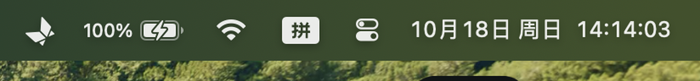

# ScreenBridge · 手机投屏

> 一个「零配置、免驱、菜单栏常驻」的 macOS 手机投屏工具。
> 连接手机即可把手机屏幕投到 Mac，USB 优先、无线兜底，绿色 = 运行中，灰色 = 已停止。


## ✨ 功能特性

- 🖥️ **菜单栏常驻**：App 启动后只占菜单栏一个图标，不干扰桌面工作
- 🔌 **USB 优先，无线兜底**：自动发现已连接设备，USB 有线投屏最稳定，无 USB 时自动尝试无线
- 📶 **即插即用**：无需安装手机端 App，无需配对，手机开启「USB 调试」即可
- 🟢 **状态一目了然**：菜单栏图标绿色 = 投屏运行中，灰色 = 已停止
- 🔄 **自动刷新**：每 2 秒自动检测设备状态与投屏运行状态
- 🎯 **投屏参数自动优化**：内置 1600p 上限 + H.264 硬解，流畅清晰
- 🎨 **符号化投屏图标（v16）**：深蓝紫渐变底色 + 白色屏幕镜像符号 + 安卓绿点 + 鸿蒙红弧，一眼可辨、风格统一

## 📸 截图

> 投屏效果图占位：欢迎提交 PR 补充实际投屏截图（放入 `assets/screenshots/` 目录并在下方引用）。

| 菜单栏状态 | 投屏效果 |
| --- | --- |
|  | 截图占位 2 |

## 🖥️ 系统要求

| 项目 | 要求 |
| --- | --- |
| 系统 | macOS 12.0 及以上 |
| 芯片 | Apple Silicon（本安装包为 aarch64 构建） |
| 手机 | Android 手机，支持 USB 调试 |

> Intel Mac 用户请自行用 `scripts/build.sh` 从源码构建（需替换 x86_64 版 scrcpy 包）。

## 🚀 面向小白的快速安装（3 步）

1. **下载安装包**：从 Releases 页下载 `ScreenBridge-1.0.0.dmg`（或 `.zip`），双击打开
2. **双击「安装.command」**：如果提示输入密码，请输入你的 Mac 开机密码
3. **开始使用**：安装完成后 App 自动启动，点击屏幕右上角菜单栏图标 → 连接手机 → 点「启动投屏」

> 💡 遇到「无法打开，因为无法验证开发者」提示？安装脚本已自动解除隔离属性；
> 如仍遇到，右键 App → 打开，或运行：`xattr -dr com.apple.quarantine /Applications/ScreenBridge.app`

### 手动安装（高级用户）

```bash
# 1. 复制到应用程序目录
cp -R ScreenBridge.app /Applications/
# 2. 解除 Gatekeeper 隔离属性
xattr -dr com.apple.quarantine /Applications/ScreenBridge.app
# 3. 启动
open /Applications/ScreenBridge.app
```

## 📖 使用说明

1. **连接手机**：用 USB 数据线连接 Mac，在手机「开发者选项」中开启 **USB 调试**
2. **启动投屏**：点击菜单栏图标 → 「启动投屏」，手机屏幕即刻出现在 Mac 上
3. **停止投屏**：再次点击菜单栏图标 → 「停止投屏」
4. **退出程序**：菜单栏图标 → 「退出」

> 首次连接时手机屏幕会弹出「允许 USB 调试」对话框，请在手机上勾选「一律允许」并确认。

## 🛠️ 从源码构建

```bash
# 1. 环境要求：Xcode Command Line Tools（自带 swiftc / codesign / hdiutil）
xcode-select --install

# 2. 下载 scrcpy 官方 macOS 包（含 scrcpy / adb / scrcpy-server）
#    前往 https://github.com/Genymobile/scrcpy/releases 下载 scrcpy-macos-aarch64-v5.x.x

# 3. 构建（默认路径可直接构建）
bash scripts/build.sh
#    或指定 scrcpy 包目录
bash scripts/build.sh /path/to/scrcpy-macos-aarch64-v5.0.1
```

构建产物：

- `build/ScreenBridge.app` —— 可直接运行的 App
- `build/ScreenBridge-1.0.0.zip` —— 一键安装 zip 包
- `build/ScreenBridge-1.0.0.dmg` —— 一键安装磁盘镜像

### 仓库结构

```
screen-bridge/
├── src/ScreenBridge.swift      # 菜单栏投屏 App 源码（自包含路径，Swift/Cocoa）
├── assets/
│   ├── make_icon.py            # 图标生成脚本（v16 符号化投屏 logo：深蓝紫渐变 + 白色屏幕镜像符号 + 安卓绿点 + 鸿蒙红弧）
│   ├── icon_1024.png           # 生成的 1024px 图标
│   └── AppIcon.icns            # 应用图标
├── scripts/
│   ├── build.sh                # 一键构建脚本（编译 + 组装 .app + 签名 + 打包）
│   ├── install.sh              # 一键安装脚本（授权 + 复制 + 启动）
│   └── make_icon.sh            # 图标转换脚本（PNG -> ICNS）
├── README.md
├── LICENSE                     # 本项目源码许可证（MIT）
└── THIRD_PARTY_NOTICES.md      # 第三方依赖与合规声明
```

## ⚖️ 依赖与合规声明

ScreenBridge 依赖以下第三方组件（二进制随官方包分发，**不修改、不重新分发源码**）：

| 组件 | 用途 | 许可证 | 来源 |
| --- | --- | --- | --- |
| [scrcpy](https://github.com/Genymobile/scrcpy) | 屏幕镜像核心引擎（含 scrcpy-server） | **GPL-3.0** | 官方 Release 包 |
| adb（Android Platform Tools） | 设备发现 / 连接管理 | **Apache-2.0** | scrcpy 官方包内置 |

- 本项目通过 **独立进程命令行调用** scrcpy / adb，不链接、不修改其代码；
- 若您需要分发包含 scrcpy / adb 二进制的构建产物，请自行阅读并遵守 **GPL-3.0** 与 **Apache-2.0** 条款；
- 完整声明详见 [THIRD_PARTY_NOTICES.md](THIRD_PARTY_NOTICES.md)。

## 🔒 隐私声明

- **完全本地运行**：App 不联网、不收集任何数据、无任何遥测统计
- adb / scrcpy 仅在本地与你的手机通信（USB 或局域网无线连接）
- 本项目不会上传你的设备信息、屏幕内容或任何个人数据

## ❓ 常见问题（FAQ）

**Q: 提示「无法打开，因为无法验证开发者」？**
A: 本 App 使用 ad-hoc 签名，未通过 Apple 公证。安装脚本已自动解除隔离属性；如仍出现，右键 App →「打开」，或手动执行 `xattr -dr com.apple.quarantine /Applications/ScreenBridge.app`。

**Q: 点击「启动投屏」提示「未检测到手机」？**
A: 请检查：① USB 数据线是否支持数据传输；② 手机「开发者选项 → USB 调试」是否开启；③ 手机是否弹窗并勾选了「允许 USB 调试」。

**Q: 支持 iPhone 吗？**
A: 暂不支持，本项目基于 Android 的 adb / scrcpy 生态。

**Q: 投屏卡顿怎么办？**
A: 优先使用 USB 有线连接；关闭手机端高负载应用；确保 Mac 与手机网络稳定（无线模式）。

## 📄 许可证

本项目自身源码（`src/`、`scripts/`、`assets/` 中自研部分）采用 **MIT License**，详见 [LICENSE](LICENSE)。
第三方组件许可证见 [THIRD_PARTY_NOTICES.md](THIRD_PARTY_NOTICES.md)。
